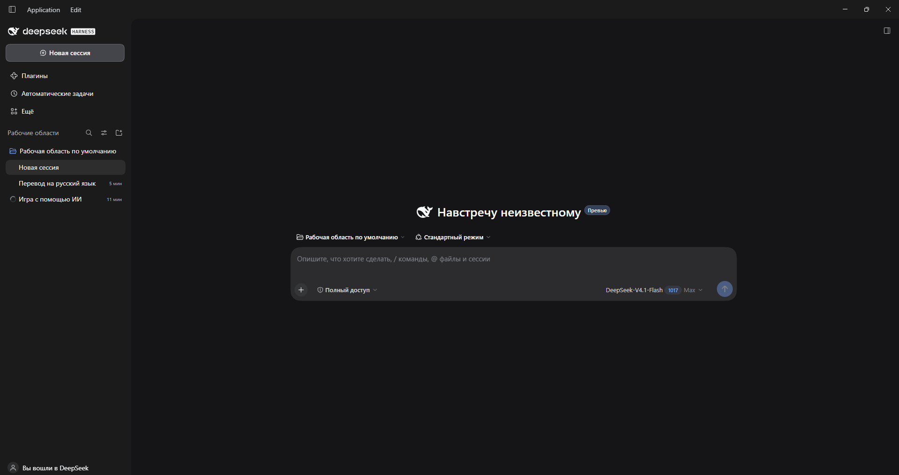

# dsh-locale-ru — Russian localization for DeepSeek Harness

A language pack plugin for the [DeepSeek Harness](https://github.com/deepseek-ai/deepseek-harness) (DSH)
web GUI. It registers the `ru` locale and ships Russian dictionaries for every shipped UI
namespace.

- **64 namespaces, 2739 strings**: chat, composer, message queue, tools, settings
  (account, models, theme, shell, plugins, web search), sidebars, document preview,
  terminal, browser, schedules, subagents, commands, onboarding.
- Plain client plugin: it does **not** patch `app.asar`, so the app integrity and
  auto-updates keep working.
- Missing keys fall back to English (`ru → en`), so partial coverage never breaks the UI.



## Install

```powershell
git clone https://github.com/sashabobkov1996/dsh-locale-ru.git
cd dsh-locale-ru
powershell -NoProfile -ExecutionPolicy Bypass -File .\scripts\install.ps1
```

Then restart DeepSeek Harness. You can also switch the language later in
**Settings → General → Language → Русский**.

Manual equivalent: `pnpm add file:C:\path\to\dsh-locale-ru` inside
`%USERPROFILE%\.dsh\profiles\desktop`, plus this entry in `cordis.patch.yml`:

```yaml
- insert:
    - id: dsh-locale-ru
      name: "dsh-locale-ru"
```

and `preference: ru` under the existing `locale` entry.

## Uninstall

```powershell
powershell -NoProfile -ExecutionPolicy Bypass -File .\scripts\rollback.ps1
```

## How it works

`lib/client.js` calls `ctx.locale.addLanguage({ id: "ru", label: "Русский", fallback: "en" })`
and then `ctx.locale.register(ns, "ru", dict)` for each namespace. Every registration is
wrapped in `try/catch`, so one bad dictionary cannot break the rest of the shell.
`lib/index.js` is an empty host half that exists only to give the Loader a tree entry.

## Updating translations

English source strings are extracted from the DSH installation, so the pack can be kept in
sync with new releases: `tools/extract-client.mjs` → `tools/extract-i18n.mjs` →
`tools/make-chunks.mjs` → translate into `i18n/work/part-NN.json` →
`tools/merge-parts.mjs` → `tools/build-plugin.mjs`. See [`i18n/GLOSSARY.md`](i18n/GLOSSARY.md)
for terminology and style rules.

## Limitations

- The **native Electron menu** (`Application`, `Edit`, `View`, …) is drawn by the app's main
  process, not the web UI, so this pack does not translate it.
- Host-provided strings (plugin descriptions from `package.json`, some system messages,
  tool and model names) stay in English.
- Command-registry copy is captured at registration time and does not switch live — a
  `dsh-client-locale` limitation.

## License

MIT.
